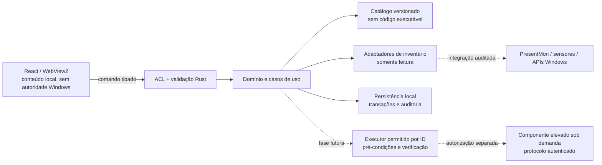

# GOAT HUB Service — arquitetura e decisões

Data da revisão: 23/10/2026. Escopo deste marco: fundação funcional, pesquisa e contratos. Este documento descreve decisões e requisitos; não certifica que módulos futuros já existem. O relatório de entrega deve registrar separadamente os testes realmente executados.

## Origem e estado inicial

Foram lidas as três especificações fornecidas pelo usuário: **PROMPT MESTRE — DESENVOLVIMENTO COMPLETO DO GOAT HUB SERVICE**, **PESQUISA ATIVA, DESCOBERTA E EXPANSÃO CONTÍNUA DO CATÁLOGO DE OTIMIZAÇÕES** e **DIRETRIZ FINAL — PADRÃO MÁXIMO DE QUALIDADE DO GOAT HUB**. Foram preservadas as instruções de `../AGENTS.md` e a auditoria anterior em `../skill-audit-2026-10-23/`.

Na primeira inspeção, `D:\gpt` continha somente `AGENTS.md`, `.agents/skills` e a auditoria das skills. Não havia aplicação, `package.json`, `Cargo.toml`, lockfile ou checkout Git identificado. Portanto, a fundação é nova; não houve migração ou substituição de aplicação existente. As skills `tauri-architecture`, `tauri-security` e `tauri-testing` orientaram esta revisão, combinadas com documentação oficial consultada nesta data.

## ADR-001 — stack desktop

**Decisão:** Tauri 2, núcleo Rust e frontend React/TypeScript compilado em ativos estáticos pelo Vite. pnpm será o gerenciador do frontend. As versões concretas devem ser fixadas e registradas nos manifests e lockfiles pelo desenvolvimento, após resolver compatibilidade; este ADR não equivale a uma seleção verificada de todas as dependências.

| Alternativa | Benefício pertinente | Compromisso para GOAT HUB | Decisão |
| --- | --- | --- | --- |
| Tauri 2 + Rust + React/Vite | Separa interface web e núcleo nativo; usa WebView2 no Windows; permite APIs Windows atrás de contratos Rust | Exige toolchain MSVC/Rust, validação do IPC e testes reais de WebView2 | Selecionada pela separação dos módulos e alinhamento à stack pretendida |
| Electron + React | Ecossistema web com processo principal Node e renderers Chromium | Adiciona runtime Node à aplicação e exige revisar a fronteira preload/renderer e integrações nativas | Viável, mas não resolve melhor as necessidades deste marco |
| WinUI 3 + C#/C++ | UI Windows nativa, XAML e integração ao Windows App SDK | Introduz outra stack de UI e exige interoperabilidade adicional para bibliotecas Rust; não há .NET/MSVC detectados no executor | Alternativa válida se requisitos futuros justificarem mudança, sem migrar preventivamente |

Comparação baseada nos modelos oficiais de [Tauri](https://v2.tauri.app/concept/process-model/), [Electron](https://www.electronjs.org/docs/latest/tutorial/process-model) e [WinUI 3](https://learn.microsoft.com/en-us/windows/apps/winui/winui3/). A preferência é uma decisão de engenharia; não foi realizado benchmark comparativo dessas stacks nem se afirma superioridade quantitativa de desempenho.

A integração documentada de [Vite com Tauri](https://v2.tauri.app/start/frontend/vite/) usa `frontendDist` apontando para a saída estática e um `devUrl` local durante desenvolvimento. A documentação consultada cobre Vite 8. Não há necessidade de Next.js, SSR, RSC, servidor Node em produção ou CDN de scripts. A [documentação Vite](https://vite.dev/guide/) declara os requisitos de Node; o Node 24.22.1 disponível satisfaz a linha mínima documentada, mas engines e peer dependencies das versões selecionadas continuam sendo verificações do lockfile.

Na implementação da fundação, os manifests passaram a fixar React 19.3.1, TypeScript 7.0.2, Vite 8.3.5 e API/CLI Tauri 2.12.4; o shell Rust fixa `tauri =2.12.5` e `tauri-build =2.7.4`, verificados no registry oficial. O shell não registra comandos próprios ou plugins. A janela normal tem lista de permissões IPC vazia; as permissões de fullscreen foram removidas. Ele está preparado em `../src-tauri/`, com build e runtime nativos ainda não comprovados. O [README nativo](../src-tauri/README.md) registra checksums, licenças, verificações estruturais e bloqueios; versões fixadas diretamente não substituem um `Cargo.lock` ainda não gerado.

## Limites de confiança

O processo Rust possui acesso ao sistema, mas **não implica execução como administrador**. A aplicação deve iniciar com o token normal do usuário. Um eventual broker elevado é uma decisão futura separada, com autenticação do cliente, autorização por operação, versão de protocolo, encerramento e atualização documentados. Não instalar serviço elevado permanente como parte da fundação.

O frontend é uma origem não confiável para decisões de segurança. Ele pode solicitar IDs de operações e parâmetros limitados; não pode enviar comandos PowerShell, caminhos arbitrários, código Rust/JavaScript a executar, nomes de serviços livres ou URLs de download. O núcleo valida novamente tipo, comprimento, enumerações, versão, condições, alvo e estado corrente. Resultados de pesquisas externas e conteúdo importado são dados, jamais instruções executáveis.

## ADR-002 — IPC, permissões e conteúdo

Usar comandos para consulta/resposta e notificações para mudanças de estado. Fluxos contínuos futuros podem usar channels, com IDs de sessão, números de sequência, cancelamento e descarte de dados antigos definidos no domínio; listeners devem ser removidos ao encerrar a tela. Não transmitir cada amostra bruta diretamente para uma árvore React inteira. Fontes: [IPC Tauri](https://v2.tauri.app/concept/inter-process-communication/) e [comunicação Rust → frontend](https://v2.tauri.app/develop/calling-frontend/).

Contratos previstos, ainda sujeitos a implementação/teste:

| Caso de uso | Entrada admitida | Saída/garantia |
| --- | --- | --- |
| Estado da aplicação | Sem argumentos sensíveis | Versão, modo, capacidades implementadas; não inventa inventário |
| Inventário | Escopo de coleta enumerado | Observações com fonte, instante, unidade e qualidade |
| Planejar alteração | IDs únicos + parâmetros conforme schema | Plano somente leitura; riscos, bloqueios e diferença esperada |
| Executar plano futuro | ID/hash do plano + confirmação específica | Revalidação no backend, operação idempotente, verificação posterior |
| Reverter operação futura | ID da execução | Confere estado atual contra estado aplicado antes de restaurar |

Um erro deve carregar código estável, mensagem legível, identificador de correlação e indicação de recuperação, sem segredos. Falha de IPC, versão incompatível ou indisponibilidade nativa não pode virar resposta de sucesso.

No Tauri 2, `invoke_handler` sozinho não restringe comandos próprios por janela. A implementação deve registrar os comandos controlados no `AppManifest::commands`, atribuir suas permissões apenas à janela necessária e testar negações. Capabilities coincidentes podem somar permissões. Não habilitar shell, processos, filesystem amplo ou origens remotas para facilitar a UI. Fonte: [capabilities oficiais](https://v2.tauri.app/security/capabilities/).

Definir CSP explícita para recursos locais e IPC necessário; inspecionar o resultado de produção e não relaxar a política em resposta a erros sem diagnóstico. Conteúdo remoto não deve receber autoridade nativa. Fontes, ícones e dependências devem ser locais ou ter origem/licença documentadas. Fonte: [CSP Tauri](https://v2.tauri.app/security/csp/). CSP é uma camada de defesa e não substitui validação de entrada, ACL ou testes.

## Mapa de módulos

| Módulo | Responsabilidade | Critério de isolamento |
| --- | --- | --- |
| Interface | Navegação, categorias, níveis, busca, filtros, detalhes, estados e foco | Não executa ajustes nem determina autorização |
| Domínio | Tipos, catálogo, compatibilidade, dependências, conflitos, cálculos e planos | Funções testáveis sem WebView nem alterações no Windows |
| Plataforma | Adaptador Tauri e modo navegador explicitamente limitado | Ausência de backend aparece como indisponibilidade |
| Inventário | Fontes Windows, cache com validade, atualização e qualidade | Leitura, timeout e coleta mínima; valor ausente não é zero |
| Catálogo | Definições imutáveis por versão e evidências | Importar dados não executa scripts ou ações |
| Recomendação | Regras explicáveis e versionadas | Não aplica automaticamente sua recomendação |
| Executor | Pré-condições, autorização, ordenação, idempotência e pós-verificação | Só operações implementadas e auditadas por ID |
| Rollback | Estado anterior, detecção de divergência e restauração | Não sobrescreve mudanças externas posteriores |
| Telemetria/benchmark | Observações e metodologia, sincronização e comparabilidade | Não afirma causalidade ou ganho sem evidência |
| Integrações | Detecção de ferramentas, versão, licença, interface suportada | Não baixa/executa remotamente de modo silencioso |
| Persistência | Preferências, sessões, migrações, histórico, recuperação | Confiança da origem e versão do schema preservadas |
| Relatórios | Dados verificados, limitações e exportação | Não cria benchmark, inventário ou sucesso ausente |
| Distribuição | Build, assinatura, atualização e cadeia de dependências | Artefato e migrations validados antes de publicação |

A organização inicial pode usar `src/domain`, `src/data`, `src/platform`, `src/components` e `src-tauri`. Novas camadas só precisam existir fisicamente quando houver implementação; o mapa não exige arquivos vazios para cada módulo futuro.

## Categorias, identidade e acessibilidade

A navegação conserva as 18 categorias do pedido: CPU, RAM, placa de vídeo, armazenamento, input, latência, rede, Windows, BIOS, energia, drivers, processos e serviços, jogos e aplicativos, periféricos, áudio, segurança, manutenção, diagnóstico e reparação. Cada categoria possui Basic, General e Advanced; os níveis não substituem categorias. Registros cruzados apontam ao mesmo ID e não duplicam execução ou histórico. Contagens são derivadas dos registros, nunca metas de marketing.

Categorias ainda sem conteúdo aprovado devem ser identificadas no planejamento, sem apresentar ferramentas fictícias. A seleção de um registro de pesquisa não equivale à seleção de uma operação executável. O estado de disponibilidade deve ser evidente antes de qualquer ação.

A interface é desktop Windows profissional, para mouse e teclado, com identidade escura/âmbar provisória e tokens centralizados em src/theme/tokens.css até receber a logo oficial. Não há modo console, Big Picture, navegação por controle ou fullscreen obrigatório. O layout deve suportar janelas menores sem esconder detalhes essenciais. Testes do navegador não certificam DPI ou WebView2 nativos. O inventário atual usa coletor PowerShell separado, importação JSON validada em memória e triagem conservadora; não há coleta automática ou executor nativo.

## Dados e persistência

Separar **definição**, **observação**, **plano**, **execução**, **resultado de teste** e **preferência**. Uma definição de catálogo não contém estado inventado do computador. Uma observação inclui fonte, versão do coletor, instante e qualidade (`confirmado`, `aproximado`, `desconhecido`, `indisponível`, `erro`); compatibilidade usa estados independentes (`confirmada`, `provável`, `incompatível`, `requer verificação`, `desconhecida`).

Registros completos de otimização incluem ID, versão, categoria, nível, mecanismo, objetivo, requisitos, plataforma, risco, evidência, referências, parâmetros, dependências, conflitos, detecção, implementação, pré/pós-condições, reversão, licença, origem e última revisão. Ausência de informação deve ser explícita. IDs e versões antigos devem continuar interpretáveis depois de atualizar o catálogo.

**ADR-003:** preferências não sensíveis e estado visual básico podem usar armazenamento local versionado na fase 1, com validação e tratamento de falhas. Isso não é um banco confiável de operações nem prova de recuperação de sessão. Antes de alterar configurações do sistema, introduzir persistência transacional no backend; SQLite é a opção preferencial a avaliar para sessões e histórico, com migrações, backup, integridade, retenção e recuperação testados. Não adicionar dependência de banco na fundação só para cumprir um diagrama. Não armazenar tokens, senhas ou identificadores pessoais desnecessários.

O plano de uma operação futura é um snapshot imutável com versão do catálogo/implementação, observações usadas, validade, estado esperado, parâmetros, efeito, riscos e autorização. Revalidar antes de executar para evitar que alterações de hardware/driver/sistema tornem o plano obsoleto. A fila deve distinguir `planejada`, `bloqueada`, `aguardando confirmação`, `em execução`, `verificada`, `falhou`, `cancelada`, `rollback necessário`, `revertida`, `reversão parcial` e `revisão manual`. Nenhum estado de sucesso pode ser derivado apenas de exit code zero.

## Fases e critérios de passagem

| Fase do pedido | Resultado verificável | Portão antes da fase seguinte |
| --- | --- | --- |
| 1. Fundação | Projeto, UI navegável, níveis por categoria, catálogo consultável, busca/filtros/detalhes, preferências, estados e testes | Build do frontend, checks pertinentes e limitações nativas documentadas; não apresentar execução fictícia |
| 2. Inventário | Dados reais de fontes identificadas com erros/ausências/qualidade | Testes dos adaptadores e validação em máquina Windows; política de coleta e validade |
| 3. Catálogo e regras | Schema completo, validação, evidência, incompatibilidades, dependências e recomendações explicadas | Cobertura real por categoria/nível e testes de regras; pesquisa não equivale a ganho comprovado |
| 4. Execução e reversão | Dry-run, autorização, estado anterior, executor, pós-verificação e rollback | Testes de falha, duplicação, cancelamento, perda de permissão e conflito; ambiente controlado |
| 5. Telemetria e benchmark | Coleta real, condições de teste, comparação e resultados inconclusivos | Métricas/fórmulas/limitações verificadas, integração licenciada e hardware apropriado |
| 6. Integrações | Adaptadores independentes com versão, origem e interface documentadas | Instalação/licença/assinatura e erros testados por ferramenta |
| 7. Recursos avançados | BIOS orientada, rede, fabricantes, perfis e retomada após reboot | Evidência específica por plataforma e recuperação demonstrada; nenhum lote crítico |
| 8. Estabilização | Instalação, assinatura, atualização, recuperação e documentação de suporte | Pacote Windows testado, dependências auditadas e critérios críticos aprovados |

O início da fase 1 pode incluir catálogo de pesquisa real que será expandido nas fases seguintes. Isso não deve ser contabilizado como otimizações implementadas. A sessão atual não autoriza testes de mutação do Windows, instalação de drivers, firmware, overclock ou alteração de proteções.

## Estratégia de validação

1. Testes puros: schemas, busca, filtros, contagens, IDs, versões, estados ausentes, planos e matemática. Os cálculos de benchmark só entram quando sua metodologia estiver definida.
2. Testes de UI: navegação, mudança de categoria/nível, busca, detalhes, foco, teclado, armazenamento corrompido/indisponível e estados vazios. Fixtures explícitas não são leitura da máquina.
3. Testes nativos: compile/check Rust, IPC permitido/negado, origem/janela, serialização, recursos, WebView2 e encerramento. Precisam de toolchain Windows e binário real.
4. Testes de execução: adaptadores isolados/fakes e depois máquina controlada, incluindo interrupção, crash e rollback divergente. Não utilizar a máquina do técnico como ambiente de otimização automática.
5. Release: build reproduzível, instalador, assinatura, migração/recuperação e atualização verificada. Nenhum critério é inferido de um build web.

A [documentação oficial de testes nativos](https://v2.tauri.app/develop/tests/webdriver/) consultada recomenda atualmente `@wdio/tauri-service`; pode usar servidor WebDriver embutido por plugin de teste, sem driver externo, ou `tauri-driver`/Edge como alternativa no Windows. Isso atualiza a referência anterior do workspace que citava apenas a rota direta. Plugins de automação com acesso a backend devem ser exclusivos de build de teste e ausentes da release. A seleção e auditoria dessa dependência ficam para a disponibilidade de um binário compilado; Playwright continua adequado para o frontend no navegador.

## Registro de fontes desta decisão

Consultadas em 23/10/2026: [pré-requisitos Tauri](https://v2.tauri.app/start/prerequisites/), [modelo de processos](https://v2.tauri.app/concept/process-model/), [IPC](https://v2.tauri.app/concept/inter-process-communication/), [capabilities](https://v2.tauri.app/security/capabilities/), [CSP](https://v2.tauri.app/security/csp/), [Vite/Tauri](https://v2.tauri.app/start/frontend/vite/), [Vite](https://vite.dev/guide/), [testes WebDriver](https://v2.tauri.app/develop/tests/webdriver/), [Electron](https://www.electronjs.org/docs/latest/tutorial/process-model), [WinUI 3](https://learn.microsoft.com/en-us/windows/apps/winui/winui3/). Páginas de documentação são referências consultadas, não código incorporado. Reavaliar os detalhes na versão fixada antes de implementar cada integração.
